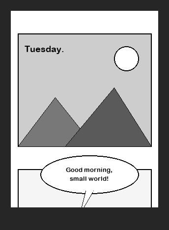

<p align="center">
  
</p>

<h1 align="center">webtoon.koplugin</h1>

<p align="center">
  <b>Webtoons on e-ink, read the way they're drawn: one long strip, one panel at a time.</b><br>
  A <a href="https://koreader.rocks">KOReader</a> plugin + a converter for Kindle, Kobo, PocketBook and friends.
</p>

<p align="center">
  <a href="https://github.com/binoy-d/webtoon.koplugin/actions"></a>
  
  
  <a href="LICENSE"></a>
</p>

---

Webtoons are made for scrolling on a phone. Cut them into pages and you get panels sliced in half
and speech bubbles split between two screens. Scroll them on e-ink and you get a smeary,
lagging mess.

**webtoon.koplugin** does something in between. Every tap glides the strip up just far enough
that **the next panel starts at the top of your screen**: a couple of quick frames for motion,
then one crisp refresh. No panel or bubble is ever split.

## Why you'll like it

- 📲 **Find and download on the device.** Search webtoons.com from KOReader, pick a series, and
  episodes download in the background while you keep reading. No computer needed.
- 🎯 **Panel snap.** Taps land on the gaps between panels, never mid-panel.
- ⚡ **Fast on e-ink.** Strips are pre-sized to your screen and the next ones are drawn while you
  read, so each tap is quick.
- 👻 **Less ghosting.** Clean refreshes, plus a full flash every 20 taps (adjustable).
- 📚 **Binge mode.** Hit the end of an episode and the next one opens.
- 🖼️ **Real covers.** Each episode gets a cover with the series, episode number and title, so
  your library looks great in the cover browser.
- 🔄 **Plays well with sync.** Deliver the same files to your reader *and* a library server
  (BookOrbit, Calibre-Web, ...) and reading progress follows you.
- 📖 **A library that remembers.** Your series, with ✓ read, ↓ downloaded and % progress on every
  episode, plus "download next 5 unread" and "check for new episodes".
- 🖐️ **Gesture-friendly.** "Webtoons: library" and "check for new episodes" can be mapped to any
  gesture or button in KOReader.
- 🧘 **Leaves your books alone.** It only activates on webtoon episodes.

## Quick start

**1. Install the plugin**

- **From KOReader:** with the [App Store plugin](https://github.com/omer-faruq/appstore.koplugin),
  search for *webtoon* and tap Install.
- **By hand:** download `webtoon.koplugin.zip` from the
  [latest release](https://github.com/binoy-d/webtoon.koplugin/releases/latest), unzip it into
  KOReader's `plugins/` folder, restart KOReader.

  | Device | Plugins folder |
  | --- | --- |
  | Kindle | `koreader/plugins/` |
  | Kobo | `.adds/koreader/plugins/` |
  | PocketBook | `applications/koreader/plugins/` |
  | Android | `koreader/plugins/` |

**2. Get some webtoons**

On the device: **Menu → Webtoons → Search webtoons…**, pick a series, then *Download next 5 unread*
(or any range, up to 10 at a time). Episodes appear in `Webtoons/<Series>/` in your home folder as
they finish. Open one and tap.

**Prefer your computer?** The `kowebtoon` converter makes the same files, faster, and can deliver to
several places at once (your reader and a book server).

<details>
<summary><b>Converter install and use</b></summary>

Python 3.9+:

```bash
pipx install git+https://github.com/binoy-d/webtoon.koplugin
```

**3. Get episodes onto your reader**

```bash
kowebtoon config --device kindle-pw5 --to /Volumes/Kindle/koreader-books/Webtoons
kowebtoon get "https://www.webtoons.com/en/<genre>/<series>/list?title_no=<id>" --episodes 1-10
```

Open an episode in KOReader and tap. The first open sets up continuous view for you.
</details>

## Keep up with a series

```bash
kowebtoon follow "https://www.webtoons.com/en/<genre>/<series>/list?title_no=<id>"
kowebtoon sync          # grabs anything new; run it whenever, or from cron
```

<details>
<summary><b>All converter options</b></summary>

| Command | What it does |
| --- | --- |
| `kowebtoon get URL --episodes 1-10` | Grab episodes (`1-10`, `3,5,8`, `latest`, or all) |
| `kowebtoon follow URL` / `unfollow NAME` | Remember a series for `sync` |
| `kowebtoon sync` | Grab new episodes of everything you follow |
| `kowebtoon list` | Show followed series |
| `kowebtoon devices` | Screen presets (Kindle, Kobo, PocketBook, reMarkable...) |
| `kowebtoon config --device ... --to ...` | Save defaults |

**Destinations (`--to`, repeatable):** a folder on the plugged-in reader, or
`ssh://user@host:port/path` (for example KOReader's own SSH server). Deliver to several places at
once, e.g. your reader *and* a book server. Add `?layout=folders` to a destination to give every
episode its own folder; servers like BookOrbit need that to list episodes as separate books.
If one destination is offline, the others still get the files; send later with `--resend`.

**Other flags:** `--margin 0.05` sets the blank space beside each panel. `--format pages` makes pre-cut, screen-shaped pages for readers without the
plugin. `--width/--height` sets a custom screen size. `--no-cover` skips the cover, and `--force`
rebuilds episodes you already have.
</details>

## How it works

<details>
<summary><b>Finding panels</b></summary>

The converter stitches each episode into one strip and looks for rows where **every** pixel is
blank. Checking every pixel matters: one pixel of a speech bubble's outline is enough to stop a
cut, so dialogue never gets split. The gaps are saved as `kowebtoon.json` *inside* the CBZ, so
they travel with the file however your KOReader stores its book settings.
</details>

<details>
<summary><b>Gliding on e-ink</b></summary>

E-ink can't do smooth 60 fps scrolling, so the plugin fakes the motion cheaply. It shows two
fast black-and-white frames (like the dithered frames in the GIF above), then does one proper
greyscale refresh on the landing spot. The landing spot is the last panel gap that was on screen,
so you always start reading at the top of a whole panel. Panels taller than the screen scroll
about 85% at a time, with a little overlap.

Images are pre-sized to your exact screen width and reduced to the 16 grey levels e-ink can show,
so KOReader never has to resize them, and the next strips are rendered in the background while
you read.
</details>

<details>
<summary><b>Settings</b> (KOReader menu → Webtoon scroll)</summary>

| Setting | Default | |
| --- | --- | --- |
| Glide frames | 2 | Fewer = snappier, more = smoother |
| Clean flash every | 20 taps | 10 / 20 / 40 / off |
| Open next episode at the end | on | |
| Glide on any tall comic | off | Glide (fixed steps, no snapping) for webtoon CBZs from other tools |
| Side margin for new downloads | 5% | Blank space left and right of each panel |
| Turn off night mode for webtoons | on | Art reads un-inverted; night mode returns when you leave |
</details>

## FAQ

<details>
<summary><b>Does it work on Kobo / PocketBook / Android?</b></summary>
It's a regular KOReader plugin with no device-specific code, so it should work anywhere KOReader
runs. It's been tested on a Kindle Paperwhite 5. Reports from other devices are very welcome.
</details>

<details>
<summary><b>Can I use webtoons I already have as CBZ files?</b></summary>
Yes: turn on <i>Glide on any tall comic</i>. You get the glide in fixed steps. Panel snapping needs
the gap map the converter adds.
</details>

<details>
<summary><b>Will it change how my books read?</b></summary>
No. It only acts on CBZs made by the converter (or tall comics, if you opt in). If anything goes
wrong, the tap falls back to KOReader's normal page turn.
</details>

## Roadmap

- Panel snapping for any webtoon CBZ, detected on the device
- More sources

## Responsible use

The plugin and the converter only fetch episodes that webtoons.com shows for free, for reading on your own
device. Please support the creators: read new episodes on WEBTOON too, and don't share the files.

## Contributing

Issues and PRs welcome. To develop:

```bash
pip install -e .
python -m unittest discover -s tests -v
python docs/make_demo_gif.py      # regenerates the demo (original art, drawn in code)
```

## License

[MIT](LICENSE)
